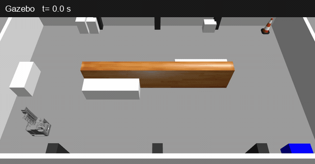
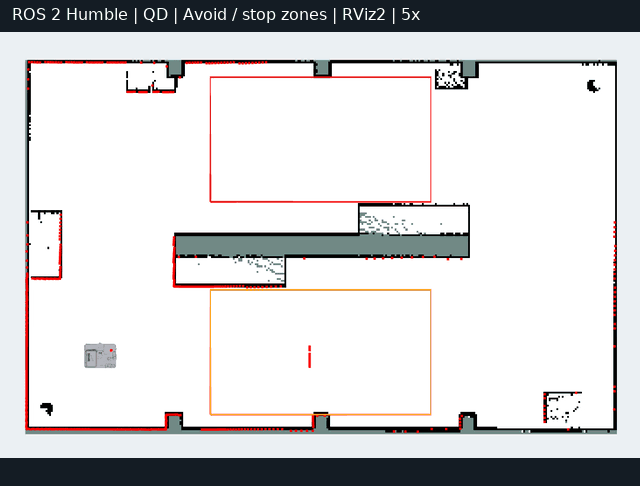
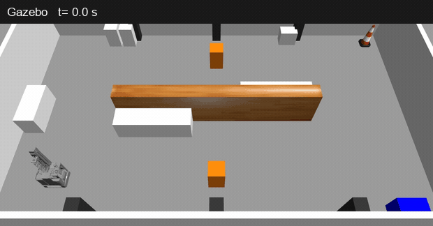
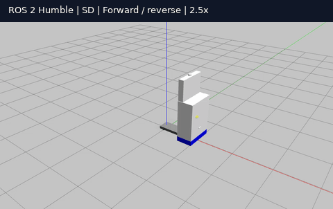
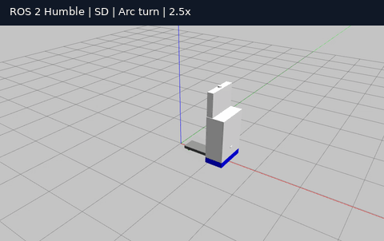
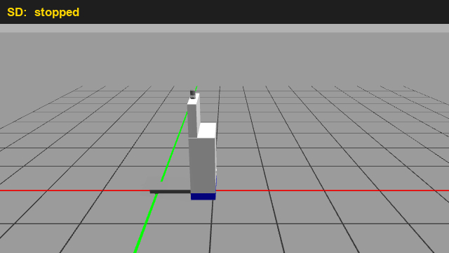
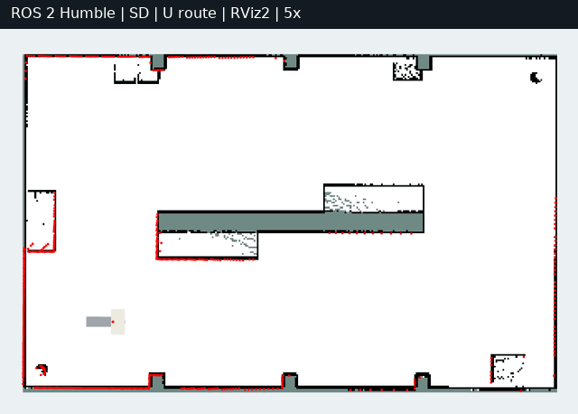
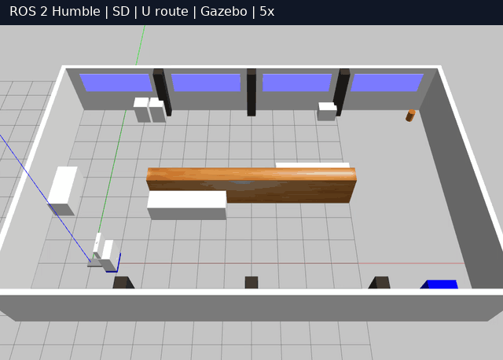
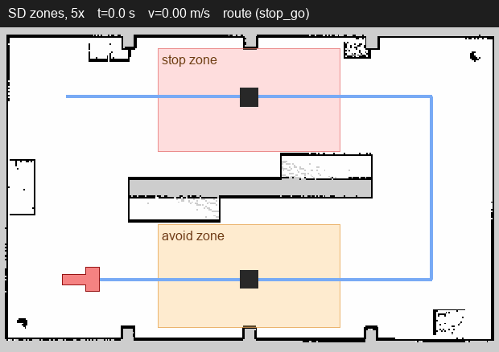
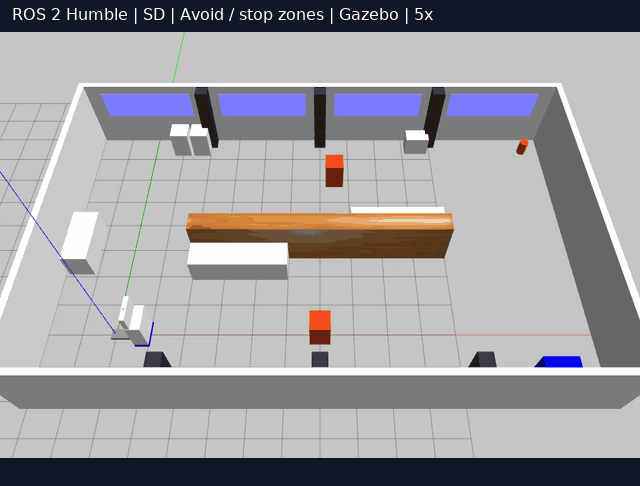

ROS1 Noetic-based simulation, kinematics, SLAM, and autonomous navigation for Wonik Robotics AGVs.

## Overview
This repository contains ROS 1 Noetic-based packages for implementing kinematics, simulation, SLAM, and autonomous navigation for four Wonik Robotics AGV models (3 QD and 1 SD).
This project is conducted as part of a joint research collaboration between Wonik Robotics and the RCI Lab at Kyung Hee University.

## Dependencies
- ROS Noetic
- Gazebo 11

## Packages
Clone this repository into the `src/` folder of a catkin workspace.

| Package | Contents |
|---|---|
| `qd_kinematics` | Steer-drive kinematics node (N-module swerve, single-drive tricycle). `/cmd_vel` → steer angles and wheel speeds with a stop → steer-align → creep → drive state machine (creep checked with the measured wheel speeds, time limits, latched FAULT); joint states → wheel odometry. Command and feedback timeouts, input validation. ROS-independent core with unit tests. Ported from `qd_kinematics2`. |
| `wonik_cobot_description` | URDF/xacro and geometry of each robot: `urdf/<robot>.urdf.xacro`, `config/<robot>/geometry.yaml` (drive unit and passive wheel positions, wheel size, LiDAR, depth camera and IMU mounts), Gazebo-only tags in `urdf/<robot>.gazebo.xacro`. `cobot_v2` (QD #2 type, without the arm): meshes converted from Wonik's STEP. `sd` (single drive, pallet-truck type): **virtual model** with primitives, dimensions read off the drawing until the CAD arrives. |
| `wonik_cobot_bringup` | One launch file per robot (`cobot_v2.launch`, `sd.launch`, both through `base.launch robot:=<robot>`) with its config in `config/<robot>/`: robot model, controller configuration, kinematics node (wheel odometry on `/wheel/odom`) and a robot_localization EKF fusing it with the IMU yaw rate into `/odom` and TF `odom → base_footprint` (`ekf:=false`: wheel odometry only). Shared by the real robot and the simulation. |
| `wonik_gazebo` | Simulation only: one launch file per robot (`cobot_v2.launch`, `sd.launch`, through `sim.launch`: world, robot, controllers, the robot's bringup, RViz), the `qd_kinematic_base` Gazebo plugin and worlds (`empty`, `wonik_hall`: a 16 m × 10 m test hall with a central island for a U-shaped route). |
| `wonik_navigation` | Everything per robot in `config/<robot>/`, selected with `robot:=<robot>` (default `cobot_v2`). 2D SLAM on the 3D LiDAR: `/points` → the robot's own body cut out → `pointcloud_to_laserscan` → `/scan` → `slam_toolbox` (`mapping.launch`), saved maps in `maps/`, AMCL localization on a saved map (`localization.launch`; odometry model omni for QD, diff for SD). Route following with move_base_flex (`navigation.launch`) and the route supervisor (`route.launch`, routes in `config/routes/`), with zones (`config/zones/`): obstacle detector (LiDAR + depth camera), zone manager and cmd_vel gate. |
| `stop_go_local_planner` | Stop-and-go route follower (nav_core plugin, structured after `neo_local_planner`): straight segments, in-place rotation at corners, pure pursuit, 1.0 m/s, no obstacle avoidance (stops and waits when its motion is blocked). A missed segment end is driven out sideways (`holonomic: true`, QD) or along the heading (`false`, SD). |
| `pure_pursuit_local_planner` | Pure pursuit follower for curved paths (nav_core plugin, structured after `neo_local_planner`), used for detours planned around obstacles; slows in curves and stops when its motion or the path ahead is blocked. |
| `local_planner_checks` | Checks shared by both planners: swept-footprint collision checks of translations and in-place turns on the costmap (any footprint polygon, convex or not, turning about `base_footprint`; unobserved and off-map cells count as blocked), stopping distance, goal reached by actual position. |

The robot-side packages talk to the drive units through ros_control (steer joints: position, drive joints: velocity) and `joint_states`, so on the real robot only the Gazebo layer is replaced by the drive unit driver (and an IMU driver on `/imu/data`). Timeouts, faults, collision checks and what the driver has to provide (its own command watchdog, stamped `joint_states`) are described in [docs/safety.md](docs/safety.md).

In Gazebo, `sim_drive` selects how the wheels move the base:
- `kinematic` (default): wheel contacts are frictionless and the `qd_kinematic_base` plugin moves the base with the twist the measured steer angles and wheel speeds imply (no slip). For SLAM and navigation.
- `physics`: the wheels drive the base through contact friction, including slip. For checking the kinematics and wheel odometry; the slip that wheel odometry cannot see in the heading is corrected by the EKF with the simulated IMU.

## Results
### cobot_v2 (QD #2 type)
cobot_v2 in Gazebo, driven with `teleop_twist_keyboard` (GIFs are sped up 2-3x).

| Mode 1: straight, sideways, diagonal | Mode 2: arc turn | Mode 3: spin in place |
|:---:|:---:|:---:|
|  |  |  |

2D SLAM in the test hall (`world:=wonik_hall`): the robot is driven around the central island; red dots are the `/scan` points (GIFs at 12x speed).

| Test hall (Gazebo) | Mapping (slam_toolbox) | Localization (AMCL on the saved map) |
|:---:|:---:|:---:|
|  |  |  |

Stop-and-go along the U route (`stop_go` controller, AMCL on the saved map): straight legs at up to 1.0 m/s, a stop and an in-place turn at every waypoint (5x speed, the same run from above and in Gazebo).

| U route | Gazebo |
|:---:|:---:|
|  |  |

Zones on the same route (`config/zones/wonik_hall.yaml`): in the avoid zone the robot drives around the obstacle on a detour from the global planner and rejoins the route; in the stop zone (and outside any zone) it stops in front of the obstacle and continues once it is removed (5x speed).

| Zones | Gazebo |
|:---:|:---:|
|  |  |

### SD (virtual model)
The SD has one steered drive unit in the body and fixed rollers at the fork tip, so it cannot move sideways and turns in place about the middle of the roller axle (`base_footprint`), with the body swinging around it. The model is built from the drawing until the CAD arrives. Same packages and planners as cobot_v2, with `config/sd/` (GIFs at 2.5x).

| Mode 1: straight | Mode 2: arc turn | Mode 3: turn in place |
|:---:|:---:|:---:|
|  |  |  |

Stop-and-go along the U route (`stop_go`, AMCL with the differential odometry model; 5x speed, the same run from above and in Gazebo):

| U route | Gazebo |
|:---:|:---:|
|  |  |

Zones on the same route, as for cobot_v2 (5x speed):

| Zones | Gazebo |
|:---:|:---:|
|  |  |

## Quick start
```bash
sudo apt install ros-noetic-desktop-full python3-rosdep
mkdir -p ~/catkin_ws/src && cd ~/catkin_ws/src
git clone https://github.com/RCILab/RCI_wonik_robotics.git
cd ~/catkin_ws
rosdep install --from-paths src --ignore-src -y
catkin_make
source devel/setup.bash
roslaunch wonik_gazebo cobot_v2.launch          # sim_drive:=physics, gui:=false rviz:=false (headless)
roslaunch wonik_gazebo sd.launch                # or the SD (virtual model)

# another terminal (source devel/setup.bash first)
rosrun teleop_twist_keyboard teleop_twist_keyboard.py _repeat_rate:=10
```

`_repeat_rate` keeps the command coming: the base stops when `/cmd_vel` is older than 0.5 s. Keys: `i`/`,` forward/back, `Shift+J`/`Shift+L` sideways, `j`/`l` turn in place, `u`/`o` arcs, `k` stop, `z` slower (start at about 0.3 m/s). When the steering direction changes a lot, the robot stops, re-aligns the wheels and creeps before driving, so a short pause after a key change is expected.

Mapping and localization in the test hall:
```bash
roslaunch wonik_gazebo cobot_v2.launch world:=wonik_hall
roslaunch wonik_navigation mapping.launch                # another terminal; drive with teleop
rosrun map_server map_saver -f <dir>/wonik_hall          # when the map is complete

roslaunch wonik_navigation localization.launch           # instead of mapping: AMCL on maps/wonik_hall
```

Route following with zones (for the SD: `sd.launch` and `navigation.launch robot:=sd`; the same for mapping and localization):
```bash
roslaunch wonik_gazebo cobot_v2.launch world:=wonik_hall
roslaunch wonik_navigation navigation.launch             # AMCL, move_base_flex, obstacle detector, zones, gate
roslaunch wonik_navigation route.launch                  # config/routes/wonik_hall_u.yaml with config/zones/wonik_hall.yaml
rostopic pub -1 /route_supervisor/mode std_msgs/String avoid                # override zones: auto | stop_go | avoid
rostopic pub -1 /route_supervisor/controller std_msgs/String stop_go_slow   # another route controller mid-route
```

Data flow: `move_base_flex` → `/cmd_vel_raw` → `cmd_vel_gate` → `/cmd_vel` → `qd_kinematics`. Outside a running detour the gate keeps a protective field in the direction of travel that grows with speed (obstacles from the LiDAR and the front depth camera, `config/<robot>/obstacle_detector.yaml`) and stops a turn in place when the footprint (`config/<robot>/footprint.yaml`) would touch an obstacle; in every state it stops the robot when a required sensor is silent. Gazebo needs a display to render the depth camera; without one, pass `depth_camera:=false` to both the robot's Gazebo launch file and `navigation.launch`.

Tests: `catkin_make run_tests` (kinematics, collision checks, gate and detector policy, route supervisor and gate against a mock move_base_flex). Fault injection in Gazebo: `roslaunch wonik_gazebo fault_injection.launch`, then `rosrun wonik_gazebo fault_injection.py <case>` (cases in [docs/safety.md](docs/safety.md)).

## Docker
For PCs without Ubuntu 20.04 (Ubuntu 22.04/24.04, Windows 11 with WSL2, ...). The image contains ROS Noetic, Gazebo 11 and the dependencies; `docker/run.sh` mounts this repository into a catkin workspace whose build is kept in the Docker volume `rci_wonik_ws`.

```bash
git clone https://github.com/RCILab/RCI_wonik_robotics.git
cd RCI_wonik_robotics
docker build -t rci_wonik_noetic:latest docker        # once, takes a few minutes
docker/run.sh catkin_make                             # build; repeat after changing C++ code
docker/run.sh roslaunch wonik_gazebo cobot_v2.launch                    # terminal 1
docker/run.sh rosrun teleop_twist_keyboard teleop_twist_keyboard.py _repeat_rate:=10     # terminal 2
```

- `docker/run.sh` without arguments opens a shell in the container.
- Gazebo and RViz windows need an X display: run from a Linux desktop session, or from a WSL2 Ubuntu terminal on Windows 11 (WSLg). Without a display, launch with `gui:=false rviz:=false`.
- All `docker/run.sh` terminals share one roscore (`--net=host`).
- `docker volume rm rci_wonik_ws` deletes the build.

## Contact
Maintainer: yoonhyuck Jung (wjddbsgur501@khu.ac.kr)  
Lab: [RCI Lab @ Kyung Hee University](https://rcilab.khu.ac.kr)
