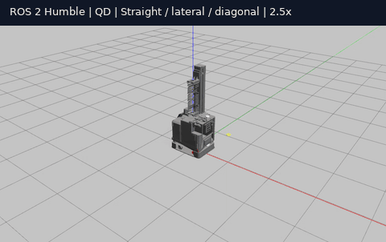
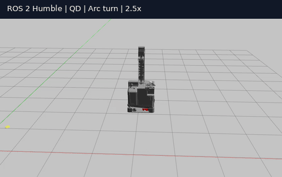
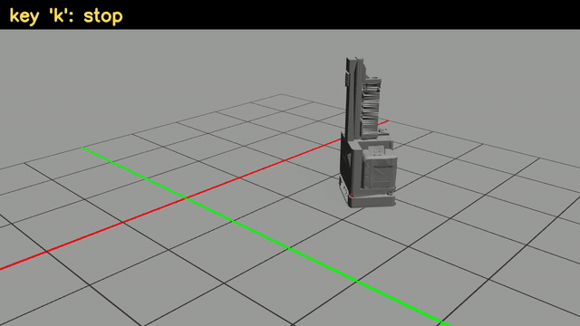
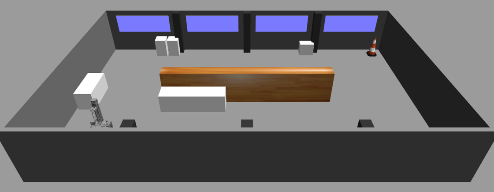
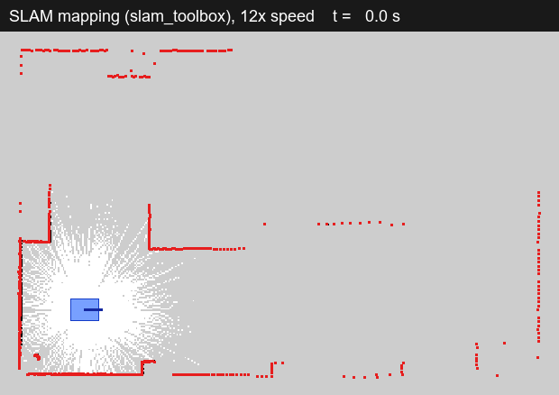
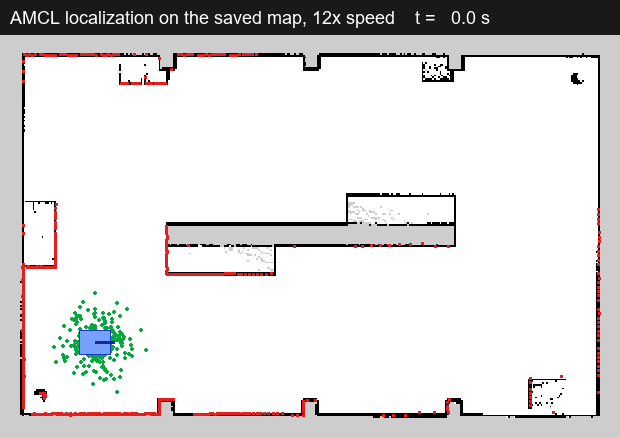
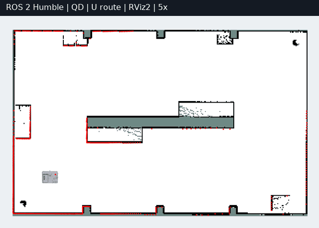
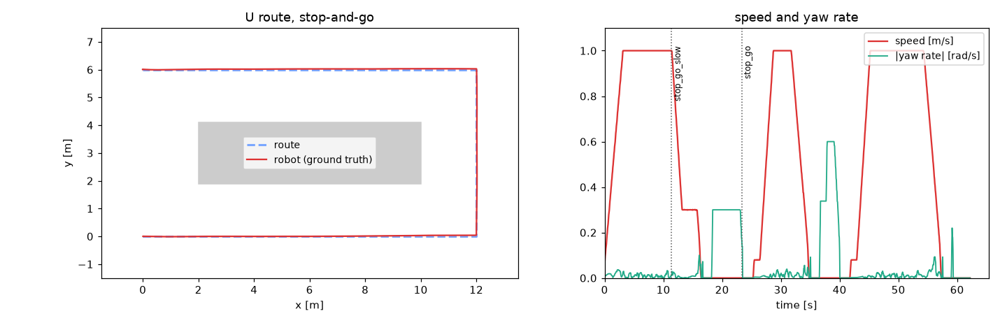

ROS1 Noetic-based simulation, kinematics, SLAM, and autonomous navigation for Wonik Robotics AGVs.

## Overview
This repository contains ROS 1 Noetic-based packages for implementing kinematics, simulation, SLAM, and autonomous navigation for four Wonik Robotics AGV models (3 QD and 1 SD).
This project is conducted as part of a joint research collaboration between Wonik Robotics and the RCI Lab at Kyung Hee University.

## Dependencies
- ROS Noetic
- Gazebo 11

## Packages
Clone this repository into the `src/` folder of a catkin workspace.

| Package | Contents |
|---|---|
| `qd_kinematics` | Steer-drive kinematics node (N-module swerve, single-drive tricycle). `/cmd_vel` → steer angles and wheel speeds with a stop → steer-align → creep → drive state machine; joint states → wheel odometry on `/odom` and TF `odom → base_footprint`. ROS-independent core with unit tests. Ported from `qd_kinematics2`. |
| `wonik_cobot_v2_description` | URDF/xacro of cobot_v2 (QD #2 type) without the arm. Meshes are converted from Wonik's STEP; geometry (drive unit and omni wheel positions, wheel size, LiDAR mount) is in `config/geometry.yaml`. Gazebo-only tags are in `urdf/wonik_cobot_v2.gazebo.xacro`. |
| `wonik_cobot_v2_bringup` | `base.launch`: robot model, controller configuration and kinematics node, shared by the real robot and the simulation. |
| `wonik_gazebo` | Simulation only: `cobot_v2.launch` (world, robot, controllers, RViz), the `qd_kinematic_base` Gazebo plugin and worlds (`empty`, `wonik_hall`: a 16 m × 10 m test hall with a central island for a U-shaped route). |
| `wonik_navigation` | 2D SLAM on the 3D LiDAR: `/points` → `pointcloud_to_laserscan` → `/scan` → `slam_toolbox` (`mapping.launch`), saved maps in `maps/`, AMCL localization on a saved map (`localization.launch`). Route following with move_base_flex (`navigation.launch`) and the route supervisor (`route.launch`, routes in `config/routes/`), which can switch controllers mid-route. |
| `stop_go_local_planner` | Stop-and-go route follower (nav_core plugin, structured after `neo_local_planner`): straight segments, in-place rotation at corners, pure pursuit, 1.0 m/s, no obstacle avoidance. |

The robot-side packages talk to the drive units through ros_control (steer joints: position, drive joints: velocity) and `joint_states`, so on the real robot only the Gazebo layer is replaced by the drive unit driver.

In Gazebo, `sim_drive` selects how the wheels move the base:
- `kinematic` (default): wheel contacts are frictionless and the `qd_kinematic_base` plugin moves the base with the twist the measured steer angles and wheel speeds imply (no slip). For SLAM and navigation.
- `physics`: the wheels drive the base through contact friction, including slip. For checking the kinematics and wheel odometry.

## Results
cobot_v2 in Gazebo, driven with `teleop_twist_keyboard` (GIFs are sped up 2-3x).

| Mode 1: straight, sideways, diagonal | Mode 2: arc turn | Mode 3: spin in place |
|:---:|:---:|:---:|
|  |  |  |

2D SLAM in the test hall (`world:=wonik_hall`): the robot is driven around the central island; red dots are the `/scan` points (GIFs at 12x speed).

| Test hall (Gazebo) | Mapping (slam_toolbox) | Localization (AMCL on the saved map) |
|:---:|:---:|:---:|
|  |  |  |

Stop-and-go along the U route (`stop_go` controller, AMCL on the saved map): straight legs at up to 1.0 m/s, a stop and an in-place turn at every waypoint. The right plot is a run where the controller is switched mid-route to a 0.3 m/s variant (`stop_go_slow`) and back; the robot changes speed without stopping.

| U route (5x speed) | Speed with mid-route controller switches |
|:---:|:---:|
|  |  |

## Quick start
```bash
sudo apt install ros-noetic-desktop-full python3-rosdep
mkdir -p ~/catkin_ws/src && cd ~/catkin_ws/src
git clone https://github.com/RCILab/RCI_wonik_robotics.git
cd ~/catkin_ws
rosdep install --from-paths src --ignore-src -y
catkin_make
source devel/setup.bash
roslaunch wonik_gazebo cobot_v2.launch          # sim_drive:=physics, gui:=false rviz:=false (headless)

# another terminal (source devel/setup.bash first)
rosrun teleop_twist_keyboard teleop_twist_keyboard.py
```

Keys: `i`/`,` forward/back, `Shift+J`/`Shift+L` sideways, `j`/`l` turn in place, `u`/`o` arcs, `k` stop, `z` slower (start at about 0.3 m/s). When the steering direction changes a lot, the robot stops, re-aligns the wheels and creeps before driving, so a short pause after a key change is expected.

Mapping and localization in the test hall:
```bash
roslaunch wonik_gazebo cobot_v2.launch world:=wonik_hall
roslaunch wonik_navigation mapping.launch                # another terminal; drive with teleop
rosrun map_server map_saver -f <dir>/wonik_hall          # when the map is complete

roslaunch wonik_navigation localization.launch           # instead of mapping: AMCL on maps/wonik_hall
```

Stop-and-go along the U route:
```bash
roslaunch wonik_gazebo cobot_v2.launch world:=wonik_hall
roslaunch wonik_navigation navigation.launch             # AMCL + move_base_flex
roslaunch wonik_navigation route.launch                  # sends config/routes/wonik_hall_u.yaml
rostopic pub -1 /route_supervisor/controller std_msgs/String stop_go_slow   # switch controllers mid-route
```

Unit tests: `catkin_make run_tests_qd_kinematics`.

## Docker
For PCs without Ubuntu 20.04 (Ubuntu 22.04/24.04, Windows 11 with WSL2, ...). The image contains ROS Noetic, Gazebo 11 and the dependencies; `docker/run.sh` mounts this repository into a catkin workspace whose build is kept in the Docker volume `rci_wonik_ws`.

```bash
git clone https://github.com/RCILab/RCI_wonik_robotics.git
cd RCI_wonik_robotics
docker build -t rci_wonik_noetic:latest docker        # once, takes a few minutes
docker/run.sh catkin_make                             # build; repeat after changing C++ code
docker/run.sh roslaunch wonik_gazebo cobot_v2.launch                    # terminal 1
docker/run.sh rosrun teleop_twist_keyboard teleop_twist_keyboard.py     # terminal 2
```

- `docker/run.sh` without arguments opens a shell in the container.
- Gazebo and RViz windows need an X display: run from a Linux desktop session, or from a WSL2 Ubuntu terminal on Windows 11 (WSLg). Without a display, launch with `gui:=false rviz:=false`.
- All `docker/run.sh` terminals share one roscore (`--net=host`).
- `docker volume rm rci_wonik_ws` deletes the build.

## Contact
Maintainer: yoonhyuck Jung (wjddbsgur501@khu.ac.kr)  
Lab: [RCI Lab @ Kyung Hee University](https://rcilab.khu.ac.kr)
